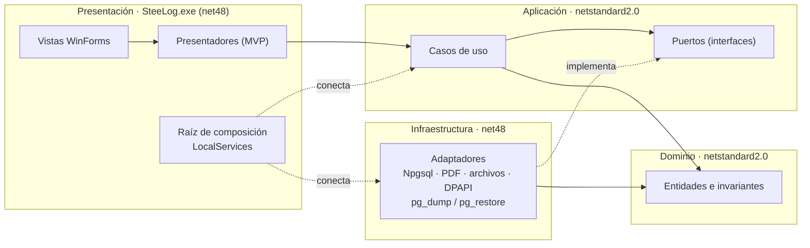
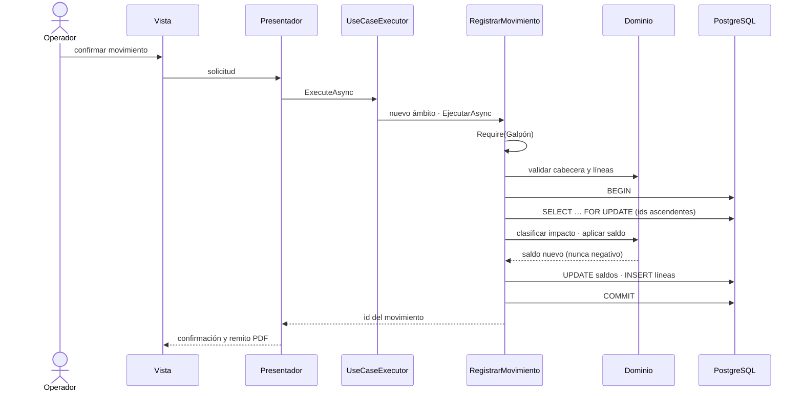
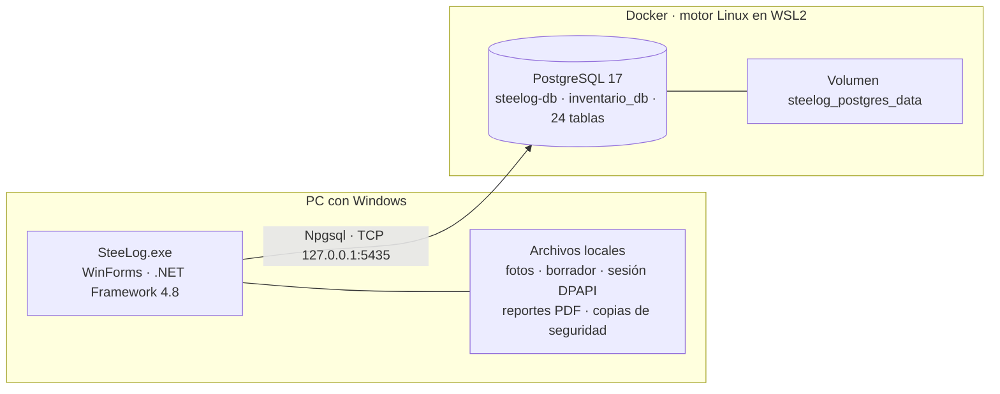
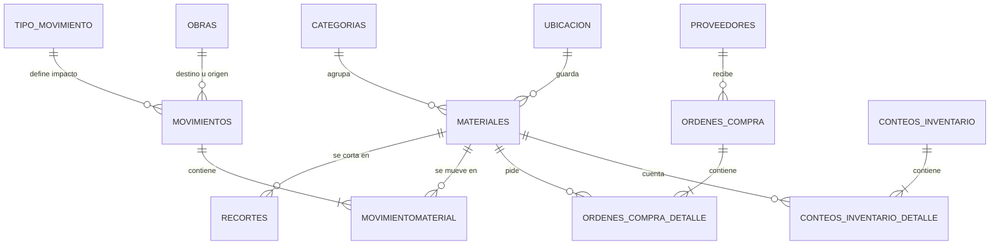

# SteeLog — Sistema de Gestión y Logística de Inventario

**SteeLog** es una aplicación de escritorio para administrar el inventario de un taller de construcción en seco (*steel framing*): materiales, recortes reutilizables, herramientas e insumos, órdenes de compra, conteos físicos y los movimientos que conectan el galpón con cada obra. Está hecha en **C# con Windows Forms (.NET Framework 4.8)** y usa **PostgreSQL 17** en un contenedor **Docker**. Todo corre en el mismo equipo, sin depender de Internet.

El código sigue los principios de la **arquitectura limpia**: cuatro proyectos (dominio, aplicación, infraestructura y presentación) cuyas dependencias apuntan siempre hacia el dominio, y una suite de pruebas que lo verifica sobre los binarios compilados.

## 📄 Documentación

| Documento | Contenido |
| --- | --- |
| [Documento técnico (PDF)](docs/exposicion/SteeLog-Documento-Tecnico.pdf) | Arquitectura, diseño por capa, modelo de datos, flujos, concurrencia, seguridad, pruebas y limitaciones. Se genera con [`generar_pdf.py`](docs/exposicion/fuente/generar_pdf.py) a partir de [`documento.html`](docs/exposicion/fuente/documento.html). |
| [Presentación (HTML)](docs/exposicion/SteeLog-Presentacion.html) | Diapositivas para la exposición. Se abre con cualquier navegador; flechas para avanzar, `F` para pantalla completa. |
| [Guía de demo y defensa](docs/arquitectura/GUIA_DEMO_Y_DEFENSA.md) | Cómo preparar un entorno de demostración aislado, con base y volumen propios. |
| [docs/arquitectura](docs/arquitectura) | Plan de arquitectura limpia y evidencias de verificación de cada fase. |

---

## 🚀 Características principales

* **Inventario y materiales:** catálogo por categoría y ubicación, stock actual, stock mínimo y alertas de reposición. Búsqueda global.
* **Movimientos:** entradas, compras, envíos a obra, devoluciones, ventas y uso interno, con carrito, borrador persistente, historial y remito en PDF. Editar o eliminar un movimiento revierte su impacto exacto.
* **Órdenes de compra:** pedido a proveedores y recepción parcial o completa.
* **Conteos físicos:** cantidades contadas contra el stock del sistema.
* **Recortes:** sobrantes reutilizables por material, medidas y estado.
* **Herramientas e insumos:** dónde está cada activo y su historial de traslados.
* **Canaletas y plegados:** trabajos a medida por obra, con fotos y estado de pago.
* **Reportes:** reporte de stock configurable, Kardex por material e informe valorizado de obra, exportables a PDF.
* **Bitácora de auditoría:** quién cambió qué y cuándo, registrado por la propia base, más los errores que vio el usuario. Exporta a Excel, TXT y Markdown.
* **Copias de seguridad:** manuales y automáticas, verificadas con SHA-256 y `pg_restore`, con retención configurable y restauración protegida.

---

## 🏛️ Arquitectura

### Capas

Cada capa es un proyecto de Visual Studio, así que la separación es una frontera de compilación y no solo una convención de carpetas. Las flechas indican quién puede depender de quién: siempre hacia el dominio.



| Proyecto | Destino | Responsabilidad | Puede depender de |
| --- | --- | --- | --- |
| `SteeLog.Domain` | netstandard2.0 | Entidades, objetos de valor e invariantes del negocio (stock nunca negativo, cantidades válidas, estados de órdenes y conteos). | Nada |
| `SteeLog.Application` | netstandard2.0 | Casos de uso (`RegistrarMovimiento`, `ConfirmarRecepcion`…) y puertos: lo que la aplicación necesita del exterior, sin decir cómo se obtiene. | Dominio |
| `SteeLog.Infrastructure` | net48 | Adaptadores que implementan los puertos: SQL con Npgsql, PDF con iTextSharp, archivos locales, DPAPI, `pg_dump`/`pg_restore`. | Aplicación, Dominio |
| `SteeLog` | net48 (ejecutable) | Formularios, presentadores y la raíz de composición, el único lugar que conoce todas las clases concretas. | Todos (solo la raíz de composición) |
| `SteeLog.Tests` | net48 | Pruebas unitarias, de presentación, de arquitectura y de integración. | — |

La regla de dependencia no depende de la disciplina: `ArchitectureTests` usa **Mono.Cecil** para leer los ensamblados compilados y falla si, por ejemplo, un formulario usa Npgsql o la aplicación referencia a la infraestructura.

### Decisiones de diseño clave

* **Unidad de trabajo por operación.** Cada caso de uso se ejecuta en un ámbito propio de inyección de dependencias, con su conexión y su transacción. No hay una conexión compartida por toda la app.
* **Bloqueo pesimista ordenado.** Antes de tocar un saldo se bloquean las filas con `SELECT … FOR UPDATE`, siempre en el mismo orden (cabecera, materiales, recortes, insumos; cada grupo por id ascendente) para evitar interbloqueos.
* **Impacto real guardado por línea.** Cada línea de movimiento guarda cuánto movió el stock y el saldo resultante. Editar o eliminar revierte exactamente eso y el Kardex se lee del historial sin recalcular.
* **Resultado incierto explícito.** Si la conexión se cae durante el `COMMIT`, la app no adivina: avisa que hay que verificar antes de reintentar, para no duplicar el movimiento.
* **Autorización en el caso de uso.** Cada operación empieza con `Session.Require(rol)`. Ocultar un botón no es la única barrera.
* **Auditoría en la base.** Un trigger genérico registra altas, cambios y bajas con el usuario, que viaja en los parámetros de la conexión. Si la auditoría falla, la operación del usuario sigue.

### Registro de un movimiento

El flujo central del sistema atraviesa todas las capas:



### Despliegue



### Modelo de datos (núcleo)

La base tiene 24 tablas. El material es la entidad central:



El origen y el destino de un movimiento son polimórficos (obra, proveedor o ubicación). Además de las reglas del dominio, la base declara restricciones `CHECK`, `NOT NULL`, claves foráneas e índices como segunda barrera, y la tabla `bitacora_auditoria` guarda la auditoría.

### Estructura del repositorio

```text
SteeLog/
├─ SteeLog.Domain/          entidades e invariantes
├─ SteeLog.Application/     casos de uso y puertos (Bitacora/, Respaldos/, Movimientos/, …)
├─ SteeLog.Infrastructure/  adaptadores Npgsql, PDF, archivos, respaldos
├─ SteeLog/                 ejecutable: CompositionRoot/, Presentation/, UI/, Vistas/
└─ SteeLog.Tests/           pruebas automatizadas
docker/
├─ init/                    esquema y datos iniciales (solo con volumen vacío)
├─ migrations/              F4, F10 y F11 para bases existentes
└─ demo/                    esquema y seed del entorno de demostración
scripts/                    verificación, pruebas de integración y demo
docs/                       documento técnico, presentación y evidencias
```

---

## 🧰 Tecnologías y por qué se eligieron

| Componente | Versión | Uso |
| --- | --- | --- |
| C# / .NET Framework | 4.8 | Aplicación de escritorio e infraestructura |
| .NET Standard | 2.0 | Dominio y aplicación (no pueden usar APIs de interfaz gráfica) |
| Windows Forms + Guna UI2 | 2.0.4.7 | Interfaz, con un sistema de tema y diálogos propio |
| PostgreSQL | 17 | Persistencia, transacciones y bloqueo de filas |
| Docker Compose | — | PostgreSQL en contenedor, publicado solo en `127.0.0.1` |
| Npgsql | 5.0.18 | Acceso a datos con SQL parametrizado |
| Microsoft.Extensions.DependencyInjection | 9.0 | Inyección de dependencias, solo en la raíz de composición |
| iTextSharp / EPPlus | — | Remitos y reportes en PDF; exportaciones a Excel |
| pg_dump / pg_restore | 17 | Copias de seguridad y restauración |
| xUnit + Mono.Cecil | 2.9 / 0.11 | Pruebas y verificación de la arquitectura |
| GitHub Actions | — | Compilación y pruebas en Debug y Release en cada push |

**Windows Forms** frente a WPF, Electron o una aplicación web: se buscaba algo **liviano**, que arranque rápido, use poca memoria y corra en las PC de oficina del taller sin un navegador ni un servidor web de por medio. WPF ofrece recursos gráficos que este dominio no necesita; Electron y una web suman un entorno de ejecución y un servidor solo para mostrar formularios.

**C# y .NET Framework 4.8** frente a .NET 8, Java o Python: es la plataforma que el autor ya dominaba y con la que nació la interfaz original, lo que permitió invertir el esfuerzo en el diseño y no en aprender otra herramienta. Además viene instalada en Windows 10 y 11. Como dominio y aplicación compilan para .NET Standard 2.0, migrar a .NET moderno solo tocaría la presentación y los adaptadores.

**PostgreSQL** frente a SQL Server, MySQL o SQLite: el software que la empresa usaba antes **ya trabajaba sobre PostgreSQL**, así que se conservó el motor y los datos históricos se migraron sin convertir tipos ni sintaxis. A eso se suma que es libre y sin licencias, transaccional, con bloqueo de filas (`FOR UPDATE`), restricciones declarativas y herramientas oficiales de copia. SQLite no admite bien varios puestos escribiendo a la vez y SQL Server exige licencia fuera de su edición limitada.

**Docker** frente a una instalación nativa: deja la base con una versión fija, aislada del resto del equipo y fácil de recrear para pruebas y demos. Con un PostgreSQL nativo la app funciona igual; solo cambia la cadena de conexión.

**SQL a mano con Npgsql** frente a Entity Framework o Dapper: da control directo sobre qué filas se bloquean y en qué orden, que es donde se juega la integridad del stock. Como los adaptadores están detrás de puertos, esa decisión no se filtra a las demás capas.

---

## 🛠️ Requisitos previos

* **Sistema operativo:** Windows 10 / 11
* **Docker Engine (WSL2) / Docker y Docker Compose:** motor Linux en ejecución (daemon local en WSL2, sin requerir la interfaz de Docker Desktop)
* **LazyDocker:** instalado y disponible en `PATH` (opcional si se inicia con `-SinInterfaz`)
* **.NET Framework 4.8 Runtime**
* **Visual Studio 2022** (opcional, para desarrollo)

---

## 📦 Puesta en marcha rápida

### 1. Iniciar PostgreSQL

Desde PowerShell, en la raíz del repositorio:

```powershell
.\docker\iniciar.ps1
```

El script valida Docker y Compose, usa explícitamente el proyecto `steelog` y este archivo Compose, inicia el servicio (límite de 120 segundos), espera hasta 60 segundos a que PostgreSQL acepte conexiones y abre LazyDocker. Si vence el límite de inicio, Docker podría continuar creando recursos: revisá su estado antes de reintentar. Para iniciar sin la interfaz: `.\docker\iniciar.ps1 -SinInterfaz`. LazyDocker solo monitorea contenedores y su vista abarca todo el daemon: evitá operar sobre contenedores o volúmenes de otros proyectos.

Compose ejecuta únicamente PostgreSQL 17 como `steelog-db`, publicado en `127.0.0.1:5435`, accesible solo desde el equipo. Si el puerto o el nombre del contenedor ya están ocupados, revisá el conflicto antes de continuar; el script no detiene ni borra la instancia ajena.

Los scripts de `docker/init` crean el esquema y los datos iniciales **solo al crear un volumen vacío**. No actualizan bases existentes ni las reinicializan al reiniciar el contenedor. El volumen `steelog_postgres_data` conserva los datos: no uses `docker compose down -v` ni limpiezas de volúmenes si querés conservarlos. Para verificar el estado sin modificar datos:

```powershell
docker compose -p steelog -f .\docker-compose.yml ps
docker compose -p steelog -f .\docker-compose.yml exec -T db pg_isready -U postgres -d inventario_db
docker compose -p steelog -f .\docker-compose.yml logs --tail 50 db
```

### 2. Configuración de conexión

El archivo privado `SteeLog/SteeLog/appsettings.json` contiene la cadena de conexión. Si no existe, la compilación lo genera a partir de `appsettings.example.json`, que apunta a PostgreSQL local en el puerto 5435. No compartas ni subas tu archivo privado.

La contraseña incluida en Compose y en el ejemplo es conocida y está destinada solo al desarrollo local; **no uses esta configuración en producción**. Cambiar una variable de Compose no rota las credenciales de un volumen PostgreSQL existente.

### 3. Ejecutar la aplicación

```text
SteeLog\SteeLog\bin\Release\SteeLog.exe
```

O abrir `SteeLog\SteeLog.sln` en Visual Studio y presionar **F5**.

### 4. Inicio de sesión (modo demostración)

* **Administrador:** usuario `admin` (o `admin@tesis.local`), contraseña `admin` (o `123456`). Acceso completo: edición de movimientos, órdenes, valorizaciones, bitácora y copias de seguridad.
* **Operador / Galpón:** usuario `galpon` (o `galpon@tesis.local`), contraseña `galpon` (o `123456`). Operación diaria, sin precios ni cantidades reservadas.

El inicio de sesión usa usuarios fijos de demostración; el puerto `IAuthentication` permite reemplazarlo por un proveedor real sin tocar casos de uso ni vistas.

---

## 🧪 Pruebas

```powershell
.\scripts\verificar.ps1
```

Compila Debug y Release y ejecuta las pruebas que no necesitan base de datos (795 casos, 616 métodos). Las pruebas de integración corren contra un PostgreSQL descartable con los scripts de `scripts/tests` (por ejemplo `inventario-integracion.ps1`, `bitacora-integracion.ps1`, `respaldos-integracion.ps1`), que crean una base temporal, aplican esquema y migraciones y la eliminan al terminar, sin tocar la base de trabajo.

---

## 🛑 Detener servicios

```powershell
docker compose -p steelog -f .\docker-compose.yml stop
```

`stop` conserva el contenedor, el volumen y los datos. Para volver a iniciar: `.\docker\iniciar.ps1 -SinInterfaz`.

---

## 💾 Copias de seguridad

Desde **Sistema → Copias de seguridad** (solo Administrador) se crean, verifican, importan, restauran y eliminan copias. Cada copia es un archivo de `pg_dump` con una ficha JSON (fecha, tipo, tamaño, filas de las tablas principales y SHA-256). La copia automática se crea al abrir la ventana principal si la última tiene más de 24 horas (configurable) y se conservan las últimas 10 automáticas (configurable). Restaurar exige escribir `RESTAURAR`, verifica la copia, crea antes una copia del estado actual y restaura en una sola transacción: si falla, la base queda como estaba.

La app busca `pg_dump` y `pg_restore` en las instalaciones de PostgreSQL de Windows (Program Files de todos los discos y servicios registrados).

---

## Migraciones para una base existente

Los esquemas de `docker/init` y `docker/demo` ya incorporan todas las migraciones; no los reinstales sobre una base existente. Para actualizar una base anterior, con un respaldo verificado y la app cerrada, ejecutá con `psql` contra **la base elegida por el administrador** primero F4 si todavía falta, luego **todos** los archivos `F10_*.sql` ordenados por nombre y por último `F11_bitacora.sql`:

```powershell
psql --dbname=$env:STEELOG_MIGRATION_CONNECTION -v ON_ERROR_STOP=1 -f docker/migrations/F4_insumo_movimientos_snapshot.sql
if ($LASTEXITCODE -ne 0) { throw "Migracion F4 fallida" }
Get-ChildItem docker/migrations/F10_*.sql, docker/migrations/F11_*.sql | Sort-Object Name | ForEach-Object {
    psql --dbname=$env:STEELOG_MIGRATION_CONNECTION -v ON_ERROR_STOP=1 -f $_.FullName
    if ($LASTEXITCODE -ne 0) { throw "Migracion fallida: $($_.Name)" }
}
```

Cada archivo es transaccional e idempotente. Los conflictos de datos se informan sin borrar ni corregir filas silenciosamente. Reiniciá la app después de migrar: la capacidad del esquema se detecta una sola vez al arrancar.

* **F4:** fotografías de estado anterior y posterior en los traslados de insumos.
* **F10:** impacto explícito de cada tipo de movimiento, restricciones e índices.
* **F11:** bitácora de auditoría (tabla, trigger genérico y activación en las tablas de negocio). Solo agrega objetos nuevos.

Sin F10 la app sigue funcionando: si falta `tipo_movimiento.impacto` o es NULL, usa el clasificador histórico por nombre. Con F10 acepta `entrada`, `salida`, `sin_impacto`, `registro_interno` y `segun_destino`.

### Decisiones de diseño F10

| Mejora | Decisión y evidencia |
| --- | --- |
| Impacto del tipo | Aplicada: cinco comportamientos, CASE con precedencia histórica; NULL conserva fallback. Los 9 nombres de la copia real permiten NOT NULL y UNIQUE; se comprueban conflictos en cada ejecución. |
| FK de movimientos a tipo | Aplicada y validada: 0 huérfanos en 10 movimientos de la copia. Las demás FK entre entidades usadas ya estaban presentes. |
| Nulos en cantidades/cabecera | Aplicados 9 NOT NULL: stocks/precio de material, cantidad de línea, origen/tipos/tipo de movimiento/flete. Sin conflictos en la copia; preflight informa tabla, columna y cantidad. Flete omitido toma 0. |
| Importes y saldo | Aplicados 4 CHECK validados: precio de material y línea, saldo de línea e importes de movimiento no negativos. Los CHECK de stock de material y cantidad de recortes ya existían. |
| Acceso por FK/WHERE/JOIN | Aplicados 20 índices, sin duplicar prefijos ya cubiertos por PK/UNIQUE: historial por material/movimiento/insumo/herramienta, ajustes por tipo-fecha y referencias a catálogos. No se afirma una mejora de tiempo medida. |
| Cantidad de línea | Ampliada a numeric(12,4): el ajuste interno admite el rango de Material (hasta 99999999.99), que no cabía en numeric(10,4). |
| Cantidad de línea positiva | Descartada como CHECK global: RegistrarAjusteAsync acumula diferencias con signo, incluso cero. La positividad de movimientos ordinarios sigue en LineaMovimiento. |
| Cantidades de órdenes decimales | Descartada: CantidadOrden.Entera y LineaOrden exigen enteros; el decimal del contrato no autoriza fracciones. |
| FK de origen/destino y snapshots | Descartadas: origen/destino de movimientos son polimórficos; snapshots F4 son evidencia histórica, no referencias vivas. Usuarios de conteos son texto, no FK a una tabla local de usuarios. |

No se necesitaron restricciones NOT VALID en la copia probada. En otra base, los preflight abortan la transacción con cantidades de conflictos; no alteran filas para hacerlas pasar. `scripts/tests/esquema-copia-real.ps1 -Dump <archivo-en-TEMP>` restaura una copia descartable, aplica F4/F10 dos veces, prueba y elimina copia y dump; nunca accede a la base real.

---

## Identidad

La solución `SteeLog/SteeLog.sln`, los namespaces y el ejecutable `SteeLog.exe` usan la identidad SteeLog. La procedencia y las variantes de la marca están en [Resources/Branding](SteeLog/SteeLog/Resources/Branding/README.md).
